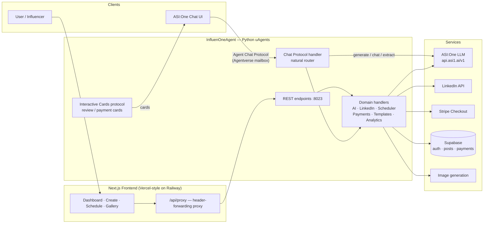
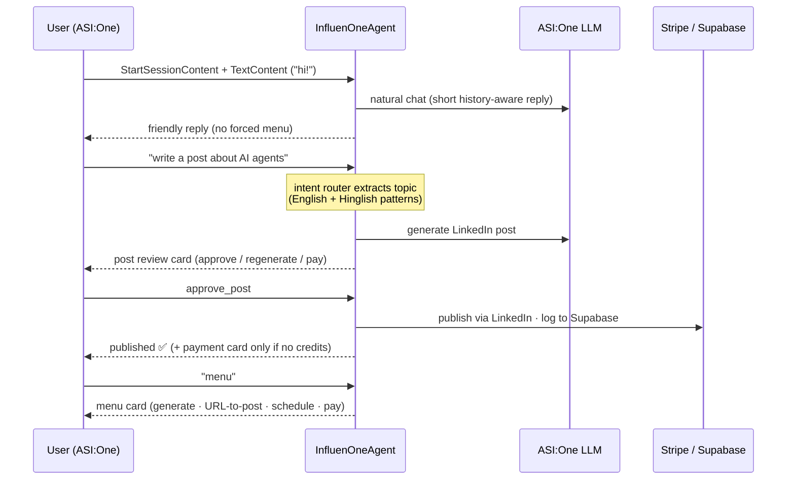

# InfluenOne 🚀

**Your AI ghostwriter for LinkedIn — powered entirely by ASI:One and built on Fetch.ai uAgents.**

InfluenOne is an autonomous agent platform that lets LinkedIn influencers **generate, review, schedule, and publish** posts in their own voice. The agent chats naturally on **ASI:One**, writes every word with **ASI-1 (the only model)**, and unlocks publishing with **Stripe or FET** on the Fetch Network.

Built for **Stranger Builds** (Fetch.ai Innovation Lab) — Challenge 1 (intent to action) + Challenge 2 (ASI-1 as the only model).

## 🔗 Live

| What | Where |
|---|---|
| 🌐 Web App | https://frontend-production-2e733.up.railway.app |
| ⚙️ Agent (REST + ACP) | https://backend-production-4e0b9.up.railway.app |
| 💬 Chat the agent on ASI:One | https://asi1.ai/ai/agent1q2yfrx8tg5mynwjcy2ferlkhhw2qq9rdxrplqj6ck4hrravv32dxz9pw4hp |
| 🪪 Agent name / address | `InfluenOneAgent` · `agent1q2yfrx8tg5mynwjcy2ferlkhhw2qq9rdxrplqj6ck4hrravv32dxz9pw4hp` |

> **Test card for Stripe checkout:** `4242 4242 4242 4242` — any future expiry, any CVC.

## ✨ Features

- **Natural agent chat on ASI:One** — talk to it like a human. Greetings, small talk, follow-ups and topic requests all flow through one intelligent router; no canned menus unless you explicitly ask for `menu`.
- **Direct intent → action** — say *"write a post about AI agents"* (or Hinglish: *"AI agents pe post banao"*) and it generates immediately.
- **URL → Post** — drop a link, get a LinkedIn post distilled from that page.
- **Human review flow** — every draft lands as an interactive review card: regenerate, edit, approve, or pay.
- **Scheduling** — cron-based scheduler publishes approved posts at the right time.
- **Templates & ideas** — idea generator + reusable post templates, all ASI-1 written.
- **Analytics** — post and payment analytics on the dashboard.
- **Payments** — Stripe Checkout (card) or FET on the Fetch Network. Web pack: **$4.99 for 10 full-access uses**.
- **Team review links** — share a draft with a tokenized review URL before publishing.

## 🏗️ Architecture



## 💬 Chat Flow (Agent Chat Protocol)

The agent follows the **veo3-agent pattern**: `StartSessionContent` never swallows the user's text — the first `TextContent` in the same message is always processed. Conversation is natural; the menu card appears **only on explicit request**.



**Payment order guarantee:** generation always happens **first**; the payment step only fires **last**, and only when the session has no credits (`paid:{sender}:{session_id}` guard prevents double-charging).

## 🧰 Full Tech Stack

### Frontend
| Tech | Version | Purpose |
|---|---|---|
| Next.js (App Router) | 16.0.10 | Web app, route groups, API proxy |
| React | 19.2.0 | UI runtime |
| TypeScript | 5.x | Type safety across the app |
| Tailwind CSS | 3.4.x | Styling (Fetch Lab theme) |
| Framer Motion | 11.x | Landing & UI animations |
| Mermaid | 11.x | In-app diagrams (tech-stack page) |
| Radix UI + shadcn-style components | latest | Accessible primitives (avatar, dropdown, dialog…) |
| axios | 1.7.x | API client with Bearer-token interceptor |
| next-themes / sonner / react-day-picker / react-markdown | latest | Theming, toasts, date picker, markdown rendering |

### Backend (the agent)
| Tech | Version | Purpose |
|---|---|---|
| Python uAgents | 0.23.4 | Agent runtime, mailbox, Agentverse registration |
| uagents-core | 0.4.0 | Agent Chat Protocol models (`ChatMessage`, `TextContent`, `StartSessionContent`…) |
| **ASI-1 via ASI:One API** | `api.asi1.ai/v1` | **The only LLM** — generation, chat, ideas, URL extraction |
| Stripe SDK | ≥11 | Stripe Checkout sessions + verification |
| Supabase | ≥2 | Auth (JWT), posts, payments, analytics |
| PyJWT + bcrypt | ≥2.8 / ≥4 | Token auth & password hashing |
| croniter | ≥2 | Scheduler expressions |
| aiohttp | ≥3.9 | REST endpoints on the agent (:8023) |
| LangChain (core/community/openai-compatible) | ≥0.1 | Chain utilities around ASI-1 |
| Slack SDK / Bolt | ≥3.27 / ≥1.18 | Slack integration (optional) |

### Infrastructure
| Tech | Purpose |
|---|---|
| Fetch.ai **Agentverse** | Agent registration, Almanac service discovery, mailbox for ASI:One chat |
| **Railway** | Hosting for both frontend and agent |
| **GitHub Actions** | CI/CD — push to `main` deploys both services |
| Docker | Containerized builds for both services |

## 🏆 Best Use of ASI:One

InfluenOne treats **ASI-1 as the single brain of the whole product** — not as an add-on:

- **100% of text generation** goes through `https://api.asi1.ai/v1`: LinkedIn posts, idea generation, URL content extraction, and the conversational chat layer. No other model is called anywhere in the codebase.
- **Natural conversation router** — ASI-1 powers small talk, follow-ups and clarification in chat, while a deterministic intent layer extracts actionable topics ("write a post about X", Hinglish included) so requests become actions **without round-trips**.
- **Context-aware replies** — per-session chat history is fed back to ASI-1 so the agent remembers what it wrote and can refine drafts conversationally.
- **Agent-side discovery** — the agent is reachable **directly from ASI:One's chat UI** via the Agent Chat Protocol, meaning ASI:One users get the full product (generate → review → pay → publish) without ever opening the web app.

## 🏆 Best Use of Fetch.ai

- **uAgents runtime** — the entire backend *is* an agent (`backend/agent.py`), not a wrapper around one: chat, REST, scheduling, and payments all live inside the uAgents lifecycle on port 8023.
- **Agent Chat Protocol (ACP)** — implements `ChatMessage` / `StartSessionContent` / `TextContent` / `EndSessionContent` / acknowledgements from `uagents-core`, making the agent a first-class citizen of the ASI:One chat ecosystem.
- **Agentverse + Almanac + Mailbox** — registered on the Agentverse with mailbox enabled, so ASI:One can reach the agent through its Almanac address without any public inbound ports.
- **Interactive Cards protocol** — custom uAgents protocol (`backend/protocols/`) that renders rich review and payment cards inside the chat, with a normalized action-selection layer (`approve_post`, `regenerate`, `pay`, …).
- **FET on the Fetch Network** — native crypto payment rail alongside Stripe: users can unlock the pack by paying in **FET** to the agent's wallet, keeping the whole loop inside the Fetch ecosystem.

## 💳 Payment Model

| Pack | Price | Includes |
|---|---|---|
| **Creator Pack — LinkedIn Post** | **$4.99** (Stripe) or FET equivalent | 10 full-access uses: generate, URL-to-post, schedule, post |

- Every generated post **delivers first**; the payment card appears only when credits are exhausted and not yet paid in that session.
- Stripe Checkout is verified server-side (`payment_status == "paid"`) before credits are granted.
- **Test card:** `4242 4242 4242 4242`, any future expiry, any CVC.

## 🏃 Run Locally

Backend (the agent):

```bash
cd backend
cp .env.example .env
pip install -r requirements.txt
python agent.py          # serves on http://localhost:8023
```

Frontend:

```bash
cd frontend
cp .env.example .env.local
npm install
npm run dev
```

- App: http://localhost:5500
- Agent: http://localhost:8023

## 🔐 Environment

| Key | Where |
|---|---|
| `ASI1_API_KEY` | backend — ASI:One LLM access |
| `STRIPE_SECRET_KEY` | backend — Stripe Checkout |
| `FET_WALLET_ADDRESS` | backend — FET payment rail |
| `SUPABASE_URL` / `SUPABASE_KEY` / `SUPABASE_SERVICE_KEY` | backend — auth + data |
| `NEXT_PUBLIC_API_BASE` | frontend — agent URL (`http://localhost:8023` locally) |

## 🚢 Deploy

Push to `main` → **GitHub Actions** (`.github/workflows/deploy.yml`) builds both Docker images and deploys to **Railway** automatically.

---

**InfluenOne** — draft in your voice, review with one tap, publish on schedule. ASI-1 writes it, Fetch.ai delivers it. ✍️